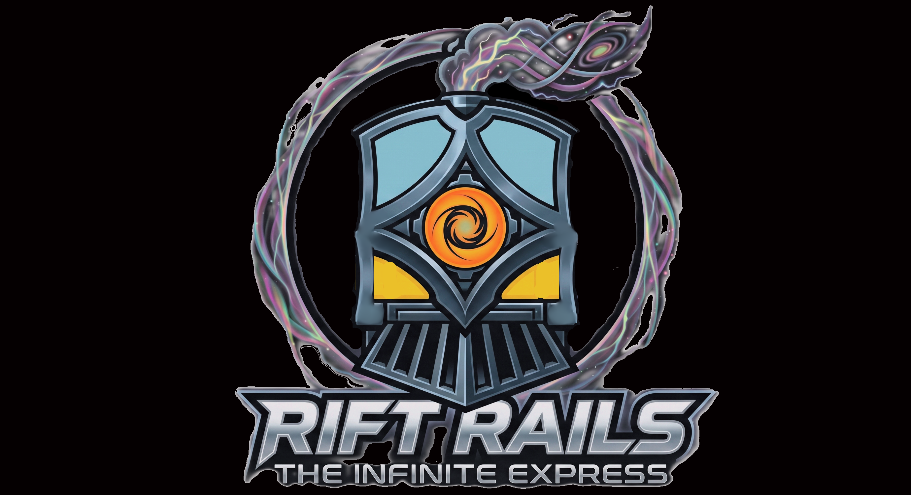

# Rift Rails

**Rift Rails** is an infinite rogue-like adventure and survival game.

---

## License

This project is licensed under a dual-licensing scheme (see [LICENSE](LICENSE) for full legal text):

1. **Software & Algorithms:** All source code (`index.html`, `artwork-browser.html`, procedural generators, shaders, logic) is licensed under the [GNU Affero General Public License v3.0 (AGPL-3.0)](https://www.gnu.org/licenses/agpl-3.0).
2. **Artwork, Graphics & Lore:** All assets (`assets/`), game lore, narrative, and aesthetic guidelines (`Artwork-rules.md`) are licensed under [Creative Commons Attribution-NonCommercial-ShareAlike 4.0 International (CC BY-NC-SA 4.0)](https://creativecommons.org/licenses/by-nc-sa/4.0/).

## Contributing

**Rift Rails is a personal project, not a community-driven initiative.**

It is built purely for the joy of creating, on my own terms, in my own time, and given away freely under open-source and Creative Commons licenses. In short, I do what I want with this.

### Want to take it in another direction?

**That is what the AGPLv3 license is for.** You have full access to the source code and complete legal freedom to fork the repository, modify the algorithms, and build your own vision.
